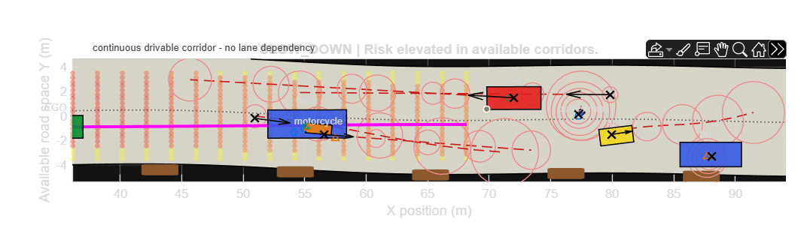
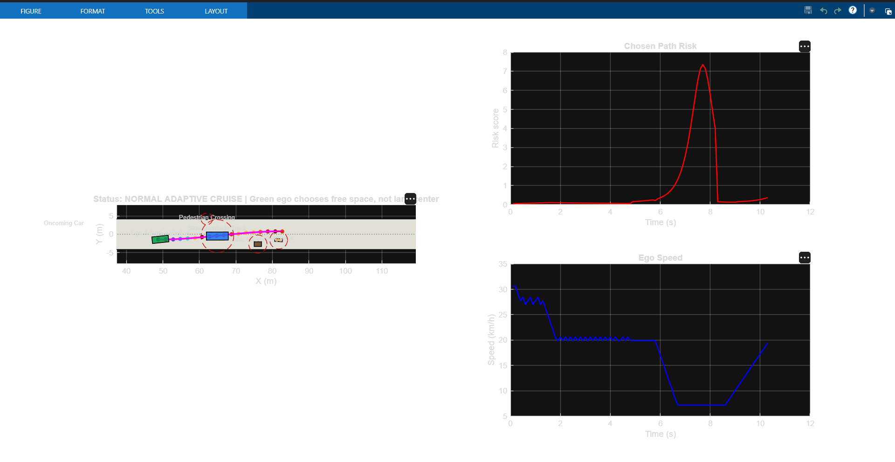
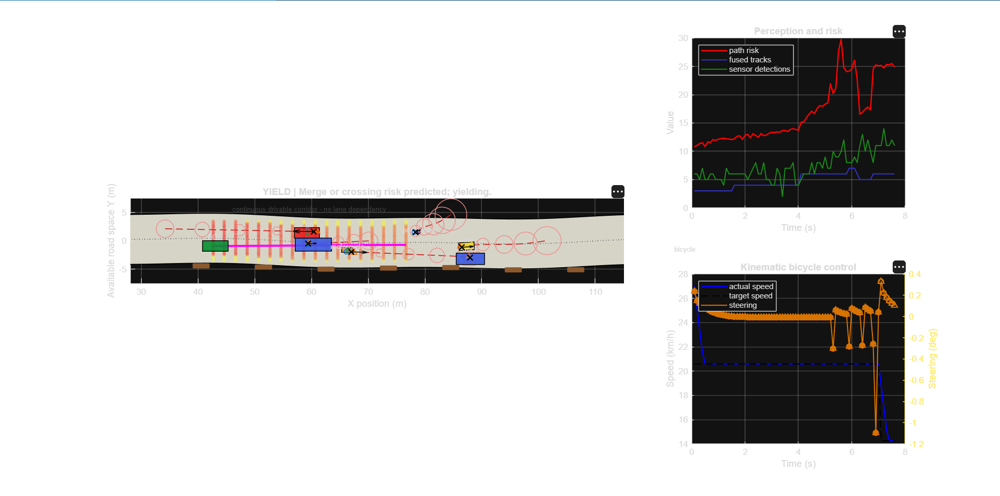
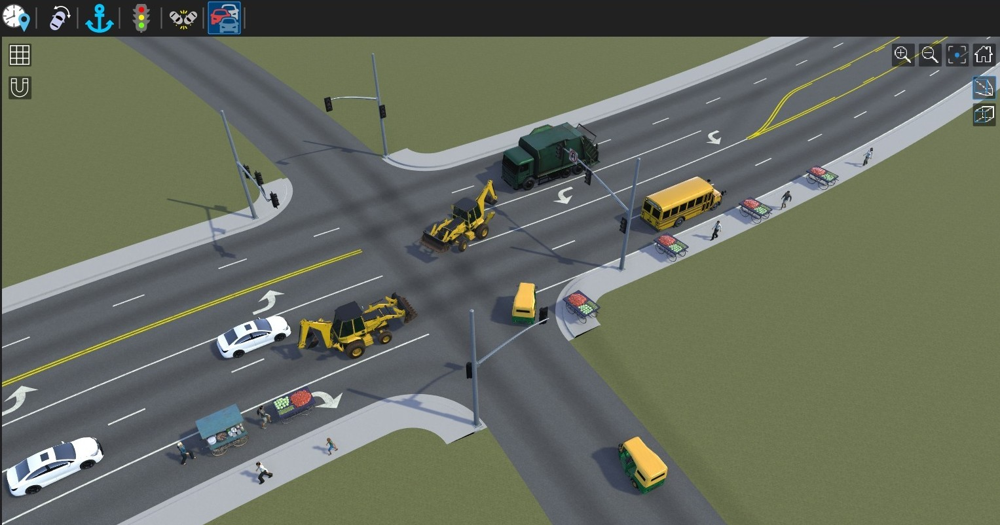

<!-- Animated header -->
<div align="center">


### Adaptive Path Planning & Collision Avoidance on Unstructured Indian Roads

**Smart India Hackathon 2026 · Problem Statement SIH26037**

[](https://www.mathworks.com/products/matlab.html)
[](https://www.mathworks.com/products/simulink.html)
[](https://www.mathworks.com/products/roadrunner.html)
[](#)

</div>

---

## 🚘 About AviX

**AviX** is a simulation-driven autonomous-driving project focused on safer navigation through the complexity of Indian roads—where lane markings may be missing, traffic is mixed, and road users can move unpredictably.

Our approach combines **environment perception, motion prediction, collision-risk assessment, adaptive trajectory planning, and closed-loop vehicle control**.

## ⚙️ How It Works

`Road Scenario` → `Perception & Sensor Fusion` → `Motion Prediction` → `Risk Assessment` → `Adaptive Path Planning` → `Steering / Acceleration / Braking` → `Closed-Loop Replanning`

- **Adapt to the road:** use lane-aware planning when markings are reliable and drivable-space planning when they are not.
- **Anticipate mixed traffic:** consider cars, buses, trucks, two-wheelers, auto-rickshaws, bicycles, pedestrians, and animals.
- **React to changing risk:** maintain speed, slow down, yield, brake, or re-plan when required.
- **Validate in simulation:** test scenarios repeatedly and assess behaviour using measurable metrics.

## 🧰 Technology Stack

| Technology | Purpose |
|---|---|
| MATLAB | Algorithm development and analysis |
| Simulink | Vehicle control and closed-loop simulation |
| RoadRunner | Indian road and traffic scenario design |
| Automated Driving Toolbox | Driving scenarios and autonomy workflows |
| Stateflow | Supervisory decision and behaviour logic |
| Git & GitHub | Version control and collaboration |

*Toolbox use and capabilities are being integrated and validated as development progresses.*

## 🎬 Project Gallery

### Adaptive Path Planning


### Risk Assessment


### Kinematic Bicycle Control


### Indian Road Scenario


## ▶️ Demo Videos

Watch the current project demonstrations:

- [AviX GUI](media/Video/AviX%20GUI%20New.mp4)
- [Dynamic Report Generation](media/Video/Dynamic%20Report%20Generation.mp4)
- [Ego Vehicle — Adaptive Path Planning](media/Video/Front_view_Ego_vehicle_with_adaptive_path_planing.mp4)
- [Indian Road Scenario — Driving Scenario Designer](media/Video/Indian_Road_on_Driving%20Scenario%20Designer_Simulation.mp4)
- [Urban Highway Merge](media/Video/Urban_Highway_Merge.mp4)

> GitHub may show video files as downloadable assets rather than playing them inline.

## 📁 Repository Structure

```text
SIH26037_Adaptive_Path_Planning_Collision_Avoidance/
├── docs/                 # Project business report and documentation
├── matlab/               # MATLAB GUI, planning and simulation scripts
├── roadrunner/            # Road/scenario demonstration assets
├── media/
│   ├── Images/            # Simulation screenshots and visual results
│   └── Video/             # Project demonstration videos
├── results/               # Generated reports and result videos
└── README.md
```

## 👥 Team AviX

| # | Team Member |
|---:|---|
| 1 | Vaishnavi Pawar |
| 2 | Abhishek Ahirrao |
| 3 | Ishaan Narakesari |
| 4 | Anurag Mohod |
| 5 | Aakanksha Sutrave |
| 6 | Sagar Sahu |

## 🎯 Current Focus

- Develop robust planning for unstructured roads and mixed traffic.
- Improve reaction to dynamic obstacles and uncertain agent motion.
- Test repeatable village-road and urban-junction scenarios.
- Evaluate safety and responsiveness using documented simulation metrics.

## ⚠️ Project Note

AviX is a **simulation and prototyping project** for SIH 2026. Simulation demonstrations are not, by themselves, evidence of real-world vehicle readiness or safety.

---

<div align="center">

**Built by Team AviX for Smart India Hackathon 2026**

<sub>Engineering safer decisions for the roads we actually drive on.</sub>

</div>
