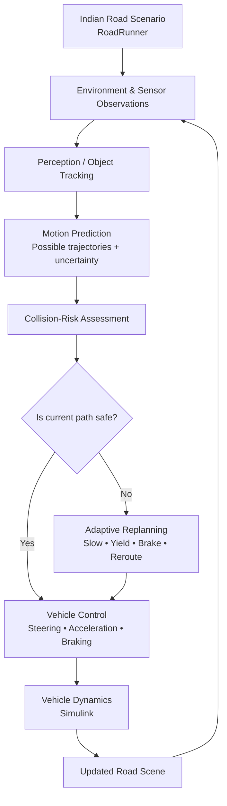

<!-- ===================== AviX | Animated README ===================== -->
<div align="center">


### Adaptive Path Planning & Collision Avoidance on Unstructured Indian Roads

**Smart India Hackathon 2026 · Problem Statement SIH26037**


</div>

---

## 🚘 About AviX

**AviX** is a simulation-driven autonomous-driving project designed to explore safer navigation on unstructured Indian roads, where lane markings may be missing and traffic participants move unpredictably.

The project brings together **road-scene simulation, motion prediction, collision-risk assessment, adaptive trajectory planning, and closed-loop vehicle control** using the MathWorks ecosystem.

## 👥 Team AviX

| # | Team Member |
|---:|---|
| 1 | Vaishnavi Pawar |
| 2 | Abhishek Ahirrao |
| 3 | Ishaan Narakesari |
| 4 | Anurag Mohod |
| 5 | Aakanksha Sutrave |
| 6 | Sagar Sahu |

## 🌆 Indian Road Simulation

<p align="center">
  
</p>

<p align="center"><em>Simulated Indian-road environment featuring mixed traffic and complex intersection movement.</em></p>

## ⚙️ Core Capabilities

<table>
<tr>
<td width="50%">

### 🛣️ Adaptive Planning
Select lane-aware planning where markings are reliable, or estimate drivable space when lanes are unclear.

</td>
<td width="50%">

### 👁️ Traffic Awareness
Consider surrounding vehicles and vulnerable road users when evaluating possible movement.

</td>
</tr>
<tr>
<td width="50%">

### ⚠️ Risk Assessment
Evaluate separation, relative motion, predicted trajectories, and collision risk.

</td>
<td width="50%">

### 🔁 Closed-Loop Response
Update steering, acceleration, or braking decisions as the simulated environment changes.

</td>
</tr>
</table>

## 🧰 Technology Stack

| Tool | Role |
|---|---|
| **MATLAB** | Algorithm development and analysis |
| **Simulink** | Vehicle dynamics and closed-loop control |
| **RoadRunner** | Road and scenario authoring |
| **Automated Driving Toolbox** | Driving scenarios and autonomy workflows |
| **Stateflow** | Supervisory decision logic |
| **Git & GitHub** | Version control and collaboration |

## 🎬 Project Demonstrations

Open the videos below to view current prototype demonstrations. GitHub may open MP4 files as downloadable media rather than playing them directly in the README.

| Demonstration | Video |
|---|---|
| AviX GUI | [▶ Watch demo](media/Video/AviX%20GUI%20New.mp4) |
| Dynamic Report Generation | [▶ Watch demo](media/Video/Dynamic%20Report%20Generation.mp4) |
| Ego Vehicle Adaptive Path Planning | [▶ Watch demo](media/Video/Front_view_Ego_vehicle_with_adaptive_path_planing.mp4) |
| Indian Road Scenario | [▶ Watch demo](media/Video/Indian_Road_on_Driving%20Scenario%20Designer_Simulation.mp4) |
| Urban Highway Merge | [▶ Watch demo](media/Video/Urban_Highway_Merge.mp4) |

## 📁 Repository Map

```text
SIH26037_Adaptive_Path_Planning_Collision_Avoidance/
├── docs/        # Project documentation and business report
├── matlab/      # MATLAB GUI, planning and simulation scripts
├── roadrunner/  # Road/scenario demonstration assets
├── media/
│   ├── Images/  # Simulation images
│   └── Video/   # Demo recordings
├── results/     # Generated reports and result videos
└── README.md
```

## 🧭 Architecture Flow

The intended system pipeline is illustrated below. Individual modules and performance are being developed and validated iteratively.



<div align="center">

**SEE → PREDICT → ASSESS RISK → PLAN → ACT → RECHECK**

<sub>Built by Team AviX for Smart India Hackathon 2026.</sub><br/>
<sub>Simulation prototype only; results do not establish real-world vehicle safety or road readiness.</sub>

</div>
